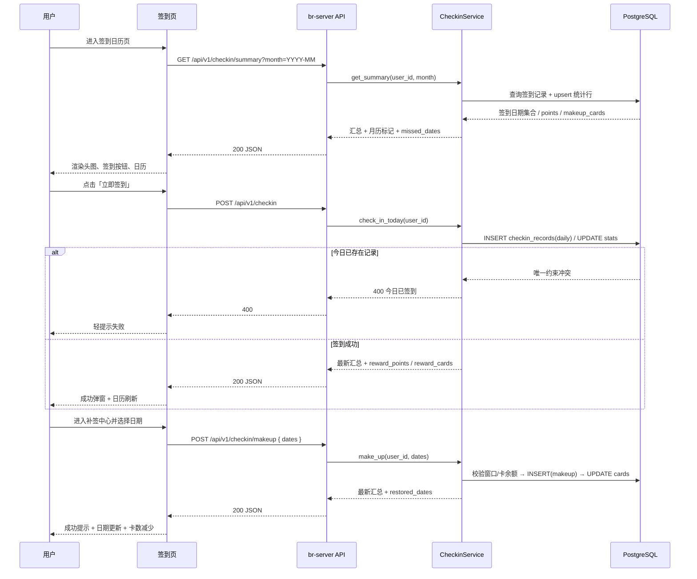

# Design: 连续签到与补签

## Context

- br-server 现有 `users` 表无积分字段，也无任何签到相关表；最接近的 `study_record_service` 只做学习时长统计，不能复用为签到数据源。
- 项目分层约定为 `api/routes → services → models → schemas`，业务日期统一使用 `Asia/Shanghai`（参考 `booking` 与 `study_record` 的时区处理）。
- br-app 已有全局 `themeMixin` 注入 `themeClass`，`uni.scss` 提供 `$surface`、`$bg-color`、`$text-primary` 等语义变量，深色模式通过 `.theme-dark` 变量覆盖生效。
- 视觉与交互以 `prototype/checkin.html`、`checkin-success.html`、`checkin-makeup.html` 为准，保持渐变头图、白色圆角卡片、周一起始日历与底部操作栏的一致风格。

## Goals / Non-Goals

**Goals:**

- 用最小新增数据面（两张新表）支撑签到、连续天数、漏签、积分与补签卡。
- 服务端对「今日」「连续天数」「漏签」「补签窗口」给出唯一口径，前端只负责展示。
- 页面在浅色/深色模式下共用一套结构与语义变量。

**Non-Goals:**

- 不做积分商城、积分流水、积分消费；本期积分仅累计展示。
- 不做签到消息推送、排行榜、运营配置化奖励规则。
- 不改动 `users` 表与既有接口。

## Decisions

### 1. 独立签到表 + 用户统计表，而非在 users 上扩字段

- `checkin_records`：`user_id` + `checkin_date` 唯一约束，`source` 区分 `daily` / `makeup`，天然防止同日重复签到。
- `user_checkin_stats`：`user_id` 主键，保存 `points` 与 `makeup_cards`；首次访问时懒创建，初始补签卡 2 张。
- 理由：签到记录是明细数据，统计字段是聚合数据，拆表避免 `users` 表膨胀与用户资料接口耦合；初始化逻辑只影响签到能力，可独立回滚。
- 备选：在 `users` 增加 `points` / `makeup_cards`。被否，因会给 `user-profile-api` 与后台用户管理引入无关字段与迁移风险。

### 2. 汇总接口一次返回「统计 + 月历 + 可补签日期」

- 单用户签到记录量级很小，服务端一次性读取该用户全部签到日期并在内存计算连续天数与漏签，避免多次查询。
- `calendar_mark` 只负责「已签/漏签/可补签」三类客观状态；「今日」「未来」由前端根据 `today` 与日期比较渲染，减少服务端与前端语义重复。
- 理由：前端切换月份只需一次请求；补签中心复用同一接口的 `missed_dates`，不需要第二套接口。

### 3. 奖励规则集中在服务端签到动作中计算

- 每日签到固定 +5；连续天数为 7 的倍数额外 +20；连续天数为 30 的倍数额外 +1 张补签卡。
- 补签只恢复记录与连续天数，不发放积分/奖励，避免「补签套利」。
- 理由：奖励与连续天数强相关，放在同一次写操作中能保证返回给弹窗的 `reward_points` / `reward_cards` 与落库结果一致。

### 4. 补签窗口固定为近 30 天且必须晚于首次签到

- 首次签到日期之前不产生漏签，避免新用户看到大片缺签。
- 今日与未来日期不可补签，今日只能通过签到按钮完成。
- 理由：规则简单、可解释，并与原型中的「仅支持近 30 天内的漏签日期」一致。

### 5. 前端两页共用一个 API 模块，页面内自管理弹窗与选择态

- `api/checkin.js` 暴露 `getCheckinSummary`、`submitCheckin`、`submitMakeup` 三个方法，沿用 `utils/request` 的鉴权与刷新机制。
- 签到成功弹窗、补签选择态均在页面内实现，不新增全局组件；视觉结构直接对照三个原型文件。
- 深色模式：页面根节点 `class="page" :class="themeClass"`，所有颜色使用 `uni.scss` 语义变量；仅渐变头图与主按钮允许使用固定品牌色（白字在两种模式下均满足对比度）。

### 6. 复杂流程时序

## Risks / Trade-offs

- [跨日边界与时区] 前后端都用本地时间会与服务器判定不一致 → 汇总响应返回服务端 `today`，前端一律以它判断「今日/未来」。
- [并发重复签到] 双击或多端同时签到可能重复发奖 → `(user_id, checkin_date)` 唯一约束兜底，冲突统一转换为 400。
- [积分/补签卡并发更新] 同一用户并发写统计行可能覆盖余额 → 单用户低频操作，且写操作在同一事务内先读后写；本期接受该风险，后续如需高并发可改为行级锁或原子 UPDATE。
- [漏签口径随首次签到变化] 用户首次签到前的日期不算漏签，一旦删除历史记录口径会变化 → 本期不提供删除签到记录的能力。
- [全量扫描签到记录] 长期用户记录数增长后汇总接口会变慢 → 单用户每天最多一条，10 年约 3650 条，内存计算可接受；后续按需增加年份过滤。
- [数据库回滚] 回滚迁移会删除签到数据 → 属预期行为，迁移 `downgrade()` 仅删除新增表，不影响既有业务表。

## Migration Plan

1. 新增 Alembic 迁移（`down_revision` 指向当前 head），创建 `checkin_records`、`user_checkin_stats` 及唯一约束/索引。
2. 部署后端并注册 `/api/v1/checkin` 路由；旧客户端无调用，行为不变。
3. 发布 br-app 新版本，个人中心出现入口；未升级客户端不受影响。
4. 回滚：先回滚 br-app 版本，再执行 `alembic downgrade -1` 删除两张表；后端代码回滚后接口消失，前端旧版本不会调用。
